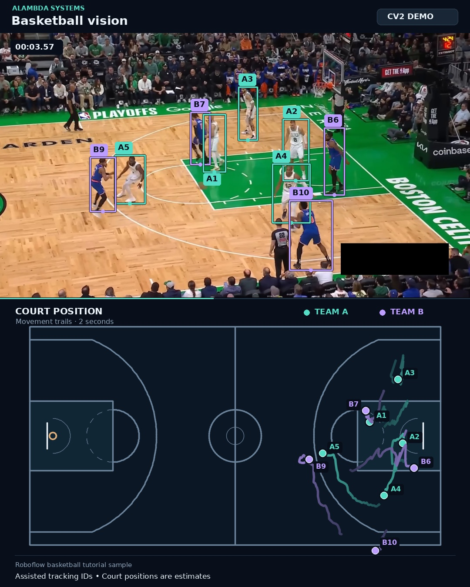

# Alambda Basketball Vision

An assisted computer-vision demo that turns basketball footage into player boxes, team-colored tracks, movement trails, and an estimated top-down court map.

Built by **Alambda Systems** with Python, OpenCV (`cv2`), and the OpenCV Zoo YOLOX-S model.

[Watch the eight-second demo](docs/demo.mp4) · [Join the free ArchTek AI community](https://www.skool.com/archtek-ai-6649/about)

[](docs/demo.mp4)

## What this demonstrates

The supplied example processes **238 frames at 30 FPS** from a short Celtics–Knicks tutorial sample. It draws player detections above a court map, uses a different color for each team, and keeps two seconds of movement history visible.

This is an **assisted experimental prototype**. The court was calibrated from six manually marked landmarks. Ten starting players were selected, and **88 identity anchors across nine frames** were reviewed to correct player associations through overlaps. Every box in the final render comes from a real YOLOX detection. Interpolated anchor positions guide association; they are never rendered as measured positions.

The labels `A1`–`A5` and `B6`–`B10` are tracking IDs. The code does not perform jersey-number OCR, facial recognition, or player-name identification.

## How it works

| Stage | Implementation |
| --- | --- |
| Player detection | YOLOX-S ONNX, run through OpenCV DNN over three overlapping image views; COCO `person` class |
| Initial association | Bounding-box overlap, optical flow, movement, and uniform-color evidence |
| Camera compensation | SIFT features and RANSAC homography estimation against the first frame |
| Court mapping | Six reviewed court landmarks and a ground-plane perspective transform |
| Identity refinement | Reviewed frame anchors guide assignment to actual detector boxes |
| Presentation | OpenCV and Pillow overlays; FFmpeg exports an H.264 MP4 at 1080 × 1350 |

The final export omits missing detections. The included JSON records those observations and estimated court coordinates so the visualization can be reproduced independently of model inference.

## Quick start: render the included tracks

Use **Python 3.12** and install **FFmpeg** so the `ffmpeg` command is available. A GPU and API key are not required for this sample. The dependencies are pinned to the versions used for the published demo.

Clone or download this repository, open its directory, and run:

```bash
python -m pip install -r requirements.txt
python download_assets.py --source-only
python render_demo.py --video assets/source.mp4 --tracks output/tracks.json --output output/demo.mp4 --preview output/demo-preview.jpg
```

The downloader checks the clip's SHA-256 before accepting it. The renderer prefers DejaVu Sans and falls back to available fonts on other systems.

## Reproduce the detection and tracking pass

The full pipeline downloads the model as well as the source clip:

```bash
python download_assets.py
python process_clip.py
python refine_identities.py
python render_demo.py --video assets/source.mp4 --tracks output/tracks.json --output output/demo.mp4 --preview output/demo-preview.jpg
```

`process_clip.py` writes the initial tracks and detector cache. `refine_identities.py` uses the checked-in review anchors to produce the final associations. These generated files stay out of Git except for the final example tracks and summary already included here.

The supplied calibration expects the original **1920 × 1080** sample. For another clip, update the initial player boxes, court landmarks, ground mask, and identity-anchor files. Different jerseys, camera angles, resolutions, and scene cuts need their own handling. Passing an arbitrary clip through the current sample calibration will not produce reliable court positions.

## Results and limits

The published output is approximately **7.93 seconds**, with **8–10 displayed detections per frame** after refinement. [The processing summary](output/processing_summary.json) records frame and observation counts; these are not precision, recall, identity-accuracy, or sports-performance measurements.

Player overlaps can still cause missed or merged boxes. The bottom-center of a detection box is only an estimate of the player's position on the floor, especially during a jump or occlusion. Court coordinates are approximate, and the project does not claim validated speed, distance, or play-analysis statistics.

The prototype and its representative frames were visually reviewed. Broader identity and detection evaluation remains future work. This repository does not reproduce the tutorial author's separate RF-DETR/SAM2/VLM recognition pipeline.

## Project files

| File | Purpose |
| --- | --- |
| `process_clip.py` | Detection, initial tracking, camera compensation, and court geometry |
| `refine_identities.py` | Association refinement using reviewed identity anchors |
| `render_demo.py` | Player overlays, court display, trails, and H.264 export |
| `download_assets.py` | Public sample/model downloads with checksum verification |
| `output/tracks.json` | Final per-frame detections and estimated court positions |
| `output/identity_anchors.json` | Reviewed white-uniform player anchors |
| `output/blue_identity_anchors.json` | Reviewed blue-uniform player anchors |
| `output/processing_summary.json` | Processing counts and review-frame summary |
| `assets/source.json` | Sample provenance |
| `docs/demo.mp4` | Processed demonstration video |

## Build with us

**[Join the free ArchTek AI community](https://www.skool.com/archtek-ai-6649/about)** to learn, build, and share AI projects with Alambda Systems. This link is for community membership; it is not a signup for a production basketball-analysis service.

Have a use case or an improvement? Open an issue with a short description and reproducible example. Useful next steps include a calibration interface, stronger tracking through occlusion, evaluation against reviewed ground truth, and experiments with footage that contributors have permission to use.

## Credits and licensing

- **Piotr Skalski / Roboflow:** [basketball tutorial](https://roboflow.com/blog/identify-basketball-players) and its [public sample notebook](https://github.com/roboflow/notebooks/blob/main/notebooks/basketball-ai-how-to-detect-track-and-identify-basketball-players.ipynb).
- **OpenCV Zoo / YOLOX:** [YOLOX-S model and Python post-processing example](https://github.com/opencv/opencv_zoo/tree/main/models/object_detection_yolox), licensed under Apache 2.0 in that model directory.
- **OpenCV, NumPy, SciPy, Pillow, and FFmpeg:** processing and rendering tools used by this project.

Our source code is distributed under [Apache License 2.0](LICENSE). See [NOTICE](NOTICE) and [THIRD_PARTY.md](THIRD_PARTY.md) for attribution and the distinction between code licensing and the third-party broadcast footage. Raw source footage and model weights are downloaded separately and are not committed to this repository.
